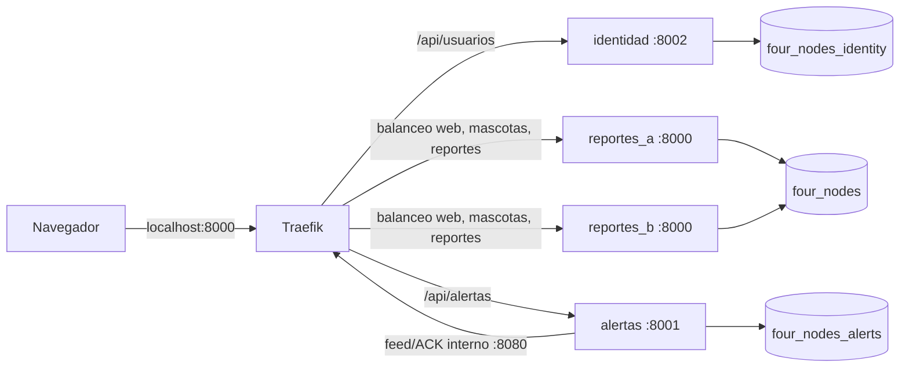

# Arquitectura final · 26 de noviembre de 2026

Las tres bases lógicas viven en **una instancia PostgreSQL**. Sólo Traefik publica el puerto 8000 al host. Compose resuelve los nombres internos por DNS. Traefik comprueba `/health/ready` cada dos segundos y puede retirar una réplica que falle. `X-Report-Instance` identifica qué copia respondió. El feed del outbox sólo se enruta por el puerto interno 8080 del gateway y exige token interno; `/api/reportes/internal/events` devuelve 404 desde el puerto público.

Identidad posee la tabla `users` en `four_nodes_identity`. Un inicializador idempotente copia cuentas antiguas de la tabla histórica de `four_nodes` sin borrar el volumen; reportes ya no monta las rutas de usuarios ni crea esa tabla en una instalación nueva. La tabla histórica se conserva para no destruir datos previos. Reportes y alertas verifican JWT localmente con la misma `AUTH_SECRET`, sin consultar identidad por cada petición privada.

Publicar un reporte confirma el reporte y el evento de outbox en una transacción de `four_nodes`. El trabajador de alertas lee el feed interno cada diez segundos, guarda una alerta única por evento y destinatario en `four_nodes_alerts`, y sólo después envía ACK. Si alertas cae, el evento queda pendiente y la publicación sigue respondiendo. Si se pierde ACK, el evento puede repetirse sin duplicar una alerta visible. Una suscripción posterior al evento no recibe avisos anteriores.

Las conversaciones privadas también pertenecen a `reportes` y se guardan en `four_nodes`. Cada conversación queda ligada a un extravío o hallazgo, a quien lo publicó y a una segunda cuenta. Ambas réplicas usan la misma base, por lo que cualquiera puede atender el siguiente mensaje. Los endpoints de lectura y respuesta exigen JWT y comprueban que la cuenta pertenezca a la conversación; para una tercera persona responden 404. Este canal no usa el trabajador de alertas: la bandeja de mensajes consulta reportes cada 30 segundos mientras la página está visible. Si cae PostgreSQL, tampoco se pueden enviar o leer mensajes.

Si cae una réplica de reportes, Traefik envía nuevas solicitudes a la sana después de detectarlo; durante esa ventana puede haber un 502 y el cliente reintenta con la misma `Idempotency-Key`. Si cae identidad, no hay registro/login, pero un JWT vigente permitió publicar en la prueba local. Si cae PostgreSQL, una publicación nueva no se confirma: es el punto de falla físico reconocido.

Pruebas reproducibles: `python3 scripts/smoke_02.py`, `python3 scripts/verify_gateway.py` y `python3 scripts/resilience_20_subscribers.py --subscribers 20 --trials 3 --timeout 150 --with-faults`. Los [resultados](RESULTADOS_FINALES.md) y el [reporte final](reporte-final.pdf) distinguen observaciones locales de garantías de servicio.
