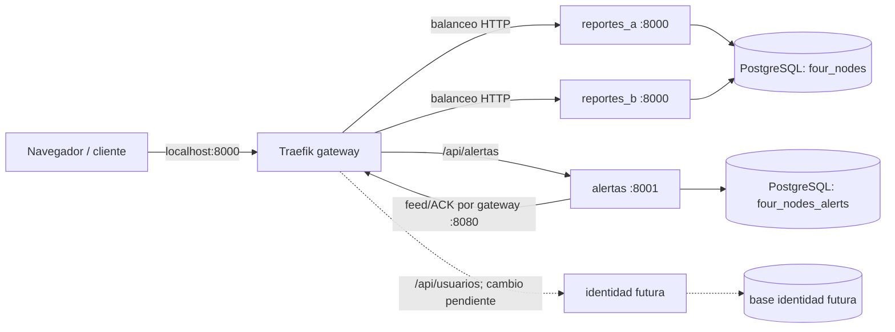

# Arquitectura de la entrega final

## Estado integrado el 14 de noviembre de 2026

La rama `02-separacion` usa Traefik como entrada a los procesos de la aplicación. Las dos réplicas `reportes_a` y `reportes_b` ejecutan el mismo código y comparten la base lógica `four_nodes`; `alertas` usa `four_nodes_alerts`. PostgreSQL sigue siendo una sola instancia: hay separación lógica de datos, no tolerancia a una caída de la base. La separación de identidad en un tercer proceso y base lógica está asignada a Ceci y aún no está integrada.



El nombre de cada contenedor resuelve por DNS interno de Compose. Traefik usa el proveedor de archivo y comprueba `/health/ready` cada dos segundos. Así se puede retirar una réplica que no responde y distribuir solicitudes entre las que siguen sanas. `X-Report-Instance` permite observar qué copia atendió una respuesta durante las pruebas. La aplicación no guarda sesiones en memoria: el JWT se verifica en cada petición y las escrituras usan PostgreSQL. Las dos réplicas conservan la misma `AUTH_SECRET` y `INTERNAL_API_TOKEN`.

## Rutas y aislamiento

| Entrada | Destino | Uso |
|---|---|---|
| `localhost:8000/`, `/api/mascotas`, `/api/reportes` | Réplicas de reportes | Web y API pública |
| `localhost:8000/api/usuarios` | Réplicas de reportes, hasta integrar a Ceci | Contrato de registro, login y perfil |
| `localhost:8000/api/alertas` | Alertas | Suscripciones y bandeja |
| `gateway:8080/api/reportes/internal` | Réplicas de reportes | Feed y ACK del outbox solo dentro de la red Compose |
| `localhost:8001/api/alertas`, `/health`, `/docs` | Alertas mediante Traefik | Compatibilidad temporal con la web anterior; Amy elimina esta dependencia |

Solo Traefik publica puertos del host. Los puertos de los procesos y de PostgreSQL permanecen dentro de la red Compose. Una petición pública a `/api/reportes/internal/events` devuelve 404; la ruta interna solo existe en la entrada 8080 de Traefik, que no se publica al host. El token interno sigue siendo obligatorio para consultar y confirmar eventos.

## Publicación, alertas y fallas

1. La réplica de reportes que recibe `POST /api/reportes/extravios` confirma el reporte y su evento pendiente en una transacción de `four_nodes`. `Idempotency-Key` impide duplicar la publicación si el cliente reintenta.
2. El trabajador de `alertas` lee el feed interno por Traefik, guarda una alerta por destinatario en `four_nodes_alerts` y después envía ACK. La restricción única de alertas permite reentregar el evento sin duplicados visibles.
3. Si `alertas` cae, la publicación sigue confirmándose y el evento queda pendiente. Al volver, el trabajador lo procesa. Si cae una réplica de reportes, Traefik la retira después de detectar el fallo; puede existir un breve 502 durante esa detección. El cliente puede reintentar la misma clave idempotente. Si cae PostgreSQL, no se confirma una publicación sin persistencia.

## Ejecución y prueba

```bash
python3 scripts/setup_env.py
docker compose up --build -d
python3 scripts/verify_gateway.py
```

`verify_gateway.py` comprueba el balanceo, oculta el feed interno, detiene `reportes_a`, ejecuta el flujo real de registro, publicación y alerta mientras `reportes_b` sirve las solicitudes, y vuelve a iniciar `reportes_a`. El script crea datos de prueba locales. Para detener sin borrar el volumen: `docker compose down`.

## Trabajo pendiente para que el diagrama sea definitivo

- **Ceci:** proceso y tercera base lógica de identidad; cambiar la ruta `identidad` de `traefik/dynamic.yaml` a su servicio y retirar las tablas/rutas de identidad de reportes.
- **Amy:** llamar `/api/alertas` desde el mismo origen; al integrar su PR, Oscar puede quitar el puerto de compatibilidad `8001` del gateway.
- **Luisa:** medir repetidamente la recuperación y los tiempos de alerta; incorporar resultados y fallas al PDF final.
- **Oscar:** revisar el diagrama después de integrar los PR y hacer la prueba final en limpio antes de fusionar `02-separacion` a `main`.
