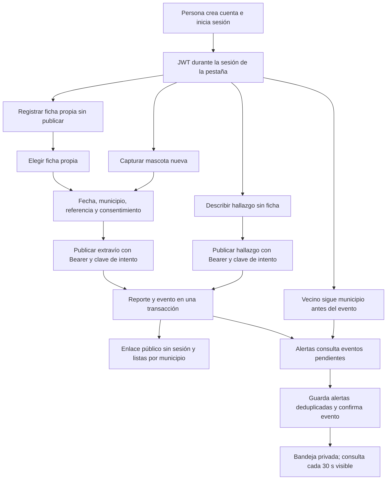

# Material de Amy para el PDF final

Preparado el 15 de noviembre de 2026. Oscar consolida el documento final en `docs/reporte-final.pdf`; este aporte y las slides no reemplazan ese archivo obligatorio.

## Problema, público y recorrido

Las personas que pierden una mascota necesitan describirla, indicar dónde fue vista y compartir un enlace público. Quien encuentra una mascota necesita publicar un hallazgo aunque no conozca a su dueño. Los vecinos pueden seguir un municipio y consultar nuevos reportes en su bandeja. El sistema concentra esas acciones sin exigir que se publique un teléfono: mostrarlo requiere consentimiento explícito.

La cuenta privada guarda fichas reutilizables. Registrar una mascota no crea automáticamente un reporte; al publicar se puede elegir una ficha propia o capturar una nueva en el mismo flujo. Los enlaces públicos se consultan sin cuenta. La autorización del servidor, no el selector de la interfaz, protege las fichas de otras personas.

## Diagrama funcional

## Decisiones de interfaz

- **Un origen:** todas las rutas web son relativas; Traefik determina su destino. Se retira la llamada fija al puerto 8001. La web ya no necesita conocer la dirección interna de alertas.
- **Sesión en pestaña:** `sessionStorage` conserva el JWT al navegar; salir o recibir 401 privado lo elimina. No se guarda la contraseña. Alternativa no adoptada en esta demo: sesión persistente entre reinicios del navegador. Antes de un despliegue público debe revisarse el modelo de sesión y de protección del navegador.
- **Reintento explícito:** el mismo cuerpo conserva su `Idempotency-Key` mientras el formulario permanezca abierto. Editarlo inicia otro intento. El servidor decide si crea o reutiliza el reporte; deshabilitar el botón por sí solo no garantiza ausencia de duplicados.
- **Datos públicos controlados:** el teléfono se envía solo con consentimiento. Las respuestas se muestran mediante `textContent`; los enlaces de alerta solo aceptan las rutas públicas esperadas del mismo origen.

Estas decisiones complementan las tres decisiones de arquitectura que el plan asigna a Oscar, Ceci y Luisa; no sustituyen sus comparaciones y evidencia.

## Capturas y límites de la evidencia

El directorio `capturas/` documenta el entorno de generación. Incorporar en el PDF capturas originales de ficha, extravío público, hallazgo público, suscripción y bandeja, con pie de figura que indique el entorno. No atribuir a pruebas locales resultados de Traefik o PostgreSQL.

La web consulta la bandeja cada 30 segundos solo cuando la página está visible; al volver consulta otra vez. Eso añade espera a la entrega del trabajador. Las mediciones de creación y visualización con 20 suscriptores corresponden al ensayo de Luisa y deben incluir varias ejecuciones.

No hay envío al teléfono, carga de fotos del usuario ni mapa. Las fotos de portada son ilustrativas. La API publica hasta 100 reportes por lista. Una recarga elimina el intento pendiente del formulario. El registro independiente de ficha no ofrece clave de idempotencia: si se pierde la respuesta, hay que refrescar la lista antes de repetir. La edición de fichas queda a cargo de Luisa y esta interfaz no afirma que ya esté implementada.

## Contribución verificable

Amy implementa los formularios y páginas públicas, consumo de JWT, hallazgos, filtros, suscripciones, bandeja, fichas separadas y reutilización, adaptación al origen único, pruebas de navegador y material del pitch. Los commits y PR de cada entrega permiten verificar la autoría. La infraestructura, APIs, PDF final y mediciones se atribuyen a sus responsables según el plan.
